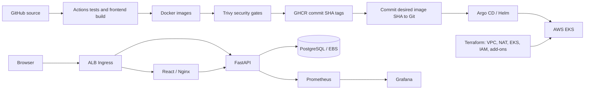

# HeroDesk - DevSecOps Capstone

Application source: `session21-python/`. Submission artifacts: `demo/`.

**Author:** Sachith Reddy

**Repository:** [Sachith77/DevOps](https://github.com/Sachith77/DevOps)

HeroDesk is an IT helpdesk for access, network, application, and hardware issues.
Staff create requests; support engineers assign priorities, advance tickets
through Open / Working / Resolved, filter the queue, and delete tickets.

This adapts the [course reference](https://github.com/Nency-Ravaliya/devsecops-python)
and your existing HeroBoard with limited application changes. The React layout,
FastAPI CRUD code, database table, and chart directory are reused. Migration
`0002_helpdesk_fields` adds requester/category fields and preserves existing tasks.
The old `/api/tasks` endpoints remain compatibility aliases. The chart, release,
and Kubernetes namespace retain the name `taskboard`.

## Architecture and stack



React/Vite, FastAPI, SQLAlchemy, PostgreSQL 16, Alembic, and Pytest form the app.
Docker, Actions, Trivy, GHCR, Terraform, EKS, Helm, Argo CD, ALB Ingress, Metrics
Server, HPA, EBS CSI, Prometheus Operator, and Grafana form the delivery stack.

## Verified work and remaining evidence

Use the [complete screenshot checklist](demo/SCREENSHOTS.md) for every required capture.
Run `.\scripts\capture-local-evidence.ps1` to save local command output under `demo/evidence/`.

See [VALIDATION.md](session21-python/VALIDATION.md) for checks performed during this update.
Source files alone do not prove a running AWS deployment. The remote pipeline,
GHCR packages, EKS deployment, Argo CD sync, live monitoring, and teardown still
need evidence from a cloud run. An AWS account and configured credentials are
prerequisites; they do not provision the infrastructure.

Each command block starts from the project directory and should run in its own
terminal when it starts a server or port forward.

The latest [GRADING.md](session21-python/GRADING.md) and [SUBMISSION.md](session21-python/SUBMISSION.md) also require
PPT/PDF slides and a recorded walkthrough. The presentation is stored in
[demo/presentation.pptx](demo/presentation.pptx); the video still needs a real narrated recording. [submission guide](demo/README.md) provides
the slide outline, recording order, and evidence checklist. Complete these before
submission. The old README's self-awarded scores and unsupported deployment
claims have been removed.

## 1. Run locally in PowerShell

Start Docker Desktop in Linux container mode, then:

```powershell
Set-Location 'D:\devops-heros\session21-python'
.\scripts\preflight.ps1 -LocalOnly
docker compose up -d --build
docker compose ps
```

Open [HeroDesk](http://localhost:3000), [Swagger](http://localhost:8000/docs),
[readiness](http://localhost:8000/ready), or [metrics](http://localhost:8000/metrics).
Compose keeps existing data in the `postgres-data` volume. Its demo database
credentials are only for local use. PostgreSQL stays on the Compose network,
without publishing a Windows host port. Inspect records with:

```powershell
Set-Location 'D:\devops-heros\session21-python'
docker compose exec postgres psql -U taskboard -d taskboard -c "SELECT id, title, requester, category, status FROM tasks;"
```

Keep the stack running during tests and browser checks. To stop it afterwards, run
`docker compose down`. Only add `-v` when you intentionally want to erase records.

### Tests and frontend development

The image and CI use Python 3.12. Run tests in the image if your host Python differs:

```powershell
Set-Location 'D:\devops-heros\session21-python'
docker compose build backend
docker run --rm --mount "type=bind,source=$((Get-Location).Path)/backend,target=/app" -w /app session21-python-backend:latest pytest -v
```

For frontend development, use a separate terminal and keep the backend running:

```powershell
Set-Location 'D:\devops-heros\session21-python'
docker compose up -d postgres backend
Push-Location frontend
try { npm.cmd ci; npm.cmd run dev } finally { Pop-Location }
```

Each test uses its own in-memory SQLite database. Compose exercises real
PostgreSQL migrations. Vite proxies `/api` to port 8000. The production Nginx
container listens on 8080 and uses `BACKEND_HOST` for service discovery.

## 2. API

| Method | Path | Purpose |
| --- | --- | --- |
| GET | /health, /ready, /metrics | Liveness, database readiness, metrics |
| GET | /api/tickets | List; optional status/category query filters |
| GET | /api/tickets/stats | Ticket counts by status |
| GET | /api/tickets/{id} | Fetch a ticket |
| POST | /api/tickets | Create a ticket |
| PUT | /api/tickets/{id} | Update a ticket |
| DELETE | /api/tickets/{id} | Delete a ticket |

Stored statuses remain `TODO`, `IN_PROGRESS`, and `DONE`. Categories are `ACCESS`,
`NETWORK`, `APPLICATION`, `HARDWARE`, and `OTHER`. Swagger documents the schemas.
The activity list displays actual ticket records instead of static deployment claims.

## 3. CI, security scans, and image promotion

The active workflow is at the repository root:
[session21-ci-cd.yml](.github/workflows/session21-ci-cd.yml).
GitHub does not discover nested `session21-python/.github/workflows` files;
the redundant inactive copy has been removed.

Pushes to `main` and `sync-to-devops` validate Python, the locked frontend build,
Helm, and Terraform. Pull requests validate without publishing images. Push runs
then build both images, scan them with Trivy, and publish commit SHA tags to
`ghcr.io/sachith77/herodesk-backend` and `herodesk-frontend` only after both scans
pass. HIGH/CRITICAL findings with an available fix fail the job. Unfixed findings
are excluded as in the reference; this does not mean the image has no vulnerabilities.
Download the `trivy-reports` artifact to inspect results.

On `main`, repository variable `GITOPS_AUTO_DEPLOY=true` enables a bot commit to
[gitops/images.yaml](session21-python/gitops/images.yaml). Argo CD reads that commit and reconciles
the chart. Enable Actions read/write repository permission for promotion; branch
protection may require a PR or approved bot credential instead. AWS keys and
kubeconfig secrets are not required in GitHub for this GitOps flow.

The initial pipeline published both images and promoted their actual commit SHA
to `gitops/images.yaml`. For a later manual promotion, run
`.\scripts\promote-images.ps1 -ImageSha <PUBLISHED_40_CHARACTER_SHA>`, then commit
and push the changed values to `main`. Automatic promotion handles normal pushes. Make
both GHCR packages public, or create a Kubernetes `ghcr-pull` registry Secret with
a read:packages token and set `imagePullSecrets: [{name: ghcr-pull}]` in chart values.
Never commit the token or Secret.

## 4. Provision AWS

Your existing AWS CLI region is **ap-southeast-2 (Sydney)**; Terraform uses the
same default. The preflight refreshes this process's PATH so tools installed from
an Administrator shell are visible. Credentials stay in your AWS configuration.

```powershell
Set-Location 'D:\devops-heros\session21-python'
cd terraform
if (-not (Test-Path terraform.tfvars)) { Copy-Item terraform.tfvars.example terraform.tfvars }
# Optional: restrict api_allowed_cidrs to your public IP /32.
terraform init
terraform fmt -check -recursive
terraform validate
terraform plan '-out=herodesk.tfplan'
```

Review the plan before applying. It creates **paid resources**: EKS, two m7i-flex.large
workers, EBS, a NAT gateway, and networking. The application later creates an ALB.
This is not a free-tier-only stack. The initial t3.medium attempt was refused by
this account's Free Tier restrictions. AWS reports m7i-flex.large as eligible in
Sydney, so workers use that type. Eligibility does not make the whole lab free.

```powershell
Set-Location 'D:\devops-heros\session21-python\terraform'
terraform apply herodesk.tfplan
cd ..
.\scripts\bootstrap-eks.ps1
.\scripts\create-db-secret.ps1 -Context herodesk-eks
```

Terraform defines two AZs with public/private subnets, private workers, EKS 1.35,
CoreDNS, kube-proxy, VPC CNI, EBS CSI, Metrics Server, the EKS Pod Identity agent,
and workload IAM roles. The account organization policy denies IAM OIDC provider
creation, so EBS CSI and the ALB controller use supported EKS Pod Identity
associations with service-account-scoped roles instead of IRSA.
The bootstrap installs the ALB controller, a gp3 StorageClass, Prometheus/Grafana,
the supplied dashboard, and Argo CD. It uses an explicit EKS context to protect
your existing Minikube setup. Verify [AWS version support](https://docs.aws.amazon.com/eks/latest/userguide/kubernetes-versions.html)
before future deployments.

## 5. Deploy through Argo CD

First ensure the bootstrap completed, `herodesk-postgres` Secret exists, images
are accessible, and the desired SHA is committed to `main`. Check the repo, branch,
and monorepo path in [argocd/application.yaml](session21-python/argocd/application.yaml), then:

```powershell
Set-Location 'D:\devops-heros\session21-python'
kubectl --context herodesk-eks apply -f argocd/application.yaml
.\scripts\wait-gitops.ps1 -Context herodesk-eks
kubectl --context herodesk-eks -n argocd get applications
kubectl --context herodesk-eks -n taskboard get pods,svc,ingress,hpa,pvc
kubectl --context herodesk-eks -n taskboard rollout status deployment/taskboard-backend
kubectl --context herodesk-eks -n taskboard rollout status deployment/taskboard-frontend
kubectl --context herodesk-eks -n argocd port-forward svc/argocd-server 8443:443
```

Open Argo CD at `https://localhost:8443`. In a private terminal, run
`.\scripts\show-login-passwords.ps1 -Context herodesk-eks` to retrieve the generated
Argo CD and Grafana admin passwords. Do not record or screenshot that output.
Open the ALB hostname reported by
`kubectl get ingress` for the application. No purchased domain is required.
Ingress routes `/api` to backend Service port **8000**, and `/` to frontend Service
port **80**, which targets Nginx on **8080**.

Argo CD renders Helm templates; it does not create a Helm release history. Its
evidence is Application Synced/Healthy and the generated workloads. If the grader
requires `helm list`, demonstrate direct Helm in a separate namespace with its own
database Secret. Do not let Helm and Argo CD independently manage the same resources.
For separate direct-Helm evidence, use a disposable namespace:

```powershell
Set-Location 'D:\devops-heros\session21-python'
kubectl --context herodesk-eks create namespace taskboard-helm-demo
.\scripts\create-db-secret.ps1 -Context herodesk-eks -Namespace taskboard-helm-demo
helm upgrade --install taskboard ./helm/taskboard --kube-context herodesk-eks -n taskboard-helm-demo -f ./helm/taskboard/values-prod.yaml -f ./gitops/images.yaml --wait --timeout 10m
helm list --kube-context herodesk-eks -n taskboard-helm-demo
```

The separate demo creates another database volume and ALB. Remove its Ingress
and wait for the ALB to disappear, then uninstall its release and delete the demo
namespace after collecting evidence. Back up records before uninstalling: the
database PVC is part of the chart. Keep its Secret while its volume exists.

## 6. Monitoring and autoscaling

Production values enable the ServiceMonitor after Prometheus CRDs are installed.
[dashboard.yaml](session21-python/monitoring/dashboard.yaml) supplies request rate, server error
rate, and average latency panels. Run each forward in a separate terminal:

```powershell
Set-Location 'D:\devops-heros\session21-python'
kubectl --context herodesk-eks -n monitoring port-forward svc/kube-prometheus-stack-grafana 3001:80
kubectl --context herodesk-eks -n monitoring port-forward svc/kube-prometheus-stack-prometheus 9090:9090
```

Open Grafana at `http://localhost:3001` with its generated admin Secret, and
Prometheus at `http://localhost:9090`. Confirm the backend target is **UP**.
Send traffic for a few minutes, then view **HeroDesk - Support API** in Grafana.

```powershell
Set-Location 'D:\devops-heros\session21-python'
.\scripts\load-test.ps1 -Url http://YOUR-ALB-HOSTNAME/api/tickets -Requests 1000
kubectl --context herodesk-eks top pods -n taskboard
kubectl --context herodesk-eks get hpa -n taskboard -w
```

The CPU HPA starts at two replicas. A light read workload may not trigger scaling.
Show actual CPU and replica changes; request count alone is not proof of scaling.
HPA scales Pods, not EC2 nodes.

## 7. Troubleshooting and cleanup

Use the deliberately broken manifests in `troubleshooting/` in a disposable
namespace. Run `.\scripts\troubleshooting-lab.ps1 -Context herodesk-eks` to
exercise and repair both failures without touching the application. Inspect Pod events for ImagePullBackOff, and Service selectors and
EndpointSlices for empty endpoints. The [demo guide](demo/README.md) lists evidence.

| Symptom | Check |
| --- | --- |
| ImagePullBackOff | Published SHA, GHCR package visibility or pull Secret |
| PostgreSQL Pending | gp3 class, EBS CSI add-on and IAM role |
| Frontend cannot start | BACKEND_HOST matches the backend Service |
| ALB returns 503 | Backend Service port 8000 and healthy /health |
| ServiceMonitor missing | Install Prometheus before enabling the monitor |
| HPA CPU unknown | Metrics Server and Pod resource requests |
| GitOps SHA unchanged | Repository variable, Actions permission, branch protection |

After saving evidence and backups, the cleanup script stops Argo reconciliation,
removes app Ingresses while the controller still runs, waits for app EBS volume
deletion, and destroys the Terraform lab. This erases its databases:

```powershell
Set-Location 'D:\devops-heros\session21-python'
.\scripts\cleanup-aws.ps1 -Context herodesk-eks
```

Terraform does not track controller-created ALBs or EBS volumes. Remove them while
their controllers still run to prevent orphans. Keep local state until destroy
completes. State, tfvars, plans, .env files, and credentials are excluded from Git.

## Limitations

This classroom application has no user login or role based access. Use synthetic
tickets. A lasting deployment needs authentication, TLS, backups, and database
operations appropriate to production. The single in-cluster PostgreSQL instance
is not a highly available managed database.
